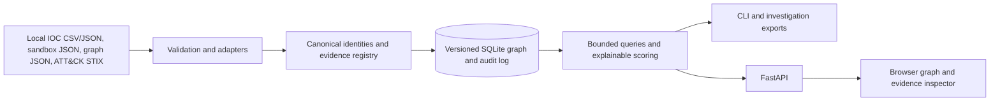

# Threat Intelligence Graph

A functional local platform for investigating cybersecurity records as evidence-backed claims.
Ingest structured intelligence offline, persist a graph in SQLite, inspect source observations,
query bounded neighborhoods, and export investigations through a CLI or analyst interface.
**An edge is a claim, not an unquestionable fact.** Connectivity never implies common ownership,
maliciousness, campaign membership, or actor identity.

## Architecture



The backend does not depend on visualization. Business logic uses `GraphStore`; SQLite implements
persistence and optimized queries. A Neo4j implementation can implement that interface later.
SQLite was selected because one analyst can develop and run it without a database service.

## Installation

Python **3.12+**; this environment was validated on 3.12.14. No database server or Node build is needed.
Run from the repository root:

```bash
python -m venv .venv
. .venv/bin/activate
python -m pip install -r requirements.txt
python -m src.main --help
python -m pytest -q
ruff check src tests scripts
```

`requirements.txt` pins the application and test dependencies. `pyproject.toml` describes compatible
ranges; module execution is the supported workflow. An optional editable install provides `tig`:
`python -m pip install --no-deps -e .`. Keep the checkout available for frontend assets.

The prepared cloud instance uses `/workspace/tig-venv/bin/python` instead of `.venv/bin/python`.
Configuration is explicit: `--db` defaults to `local/graph.sqlite3`; scoring accepts `--config
configs/scoring.json`. `TIG_ADMIN_TOKEN` enables API writes and is never required for CLI or read-only UI.
Never commit credentials; supply any optional token through your deployment's secure environment mechanism.

## Reproducible synthetic investigation

```bash
python scripts/demo.py
python -m src.main --db local/demo.sqlite3 search --value c2.example
python -m src.main --db local/demo.sqlite3 shared-indicators
python -m src.main --db local/demo.sqlite3 stats --analytics
python -m src.main --db local/demo.sqlite3 serve --port 8000
```

The demo uses documentation IP ranges, `.example` domains, fictional attribution, and a explicitly
**synthetic** ATT&CK fixture. It does not execute samples or contact observed infrastructure.
Each run produces 25 nodes, 32 claims and 15 evidence records. Repeat runs keep identities and evidence
unchanged, append import history, and create new JSON/Markdown reports in `local/exports/`.
The browser service binds loopback; this onboarding UI does not provide a web preview.
Use the local browser in a conventional development environment. Cloud validation uses local requests
and optional Chromium automation, not an external preview link.

## Input formats

See [the data contracts](docs/data_formats.md) and `data/fixtures/` for complete examples.
All imports require an actual publisher identity through `source_id` or `--source-id`.

```bash
python -m src.main ingest --file data/fixtures/iocs.json
python -m src.main ingest --file data/fixtures/iocs.csv --source-id synthetic-csv
python -m src.main ingest --file data/fixtures/attack-synthetic.json
python -m src.main ingest --file data/fixtures/sandbox.json
python -m src.main ingest --file data/fixtures/attribution.json
```

Supported adapters: normalized IOC JSON, CSV with IOC headers, documented sandbox JSON, a conservative
Cuckoo JSON subset (`--adapter cuckoo`), ATT&CK STIX 2.1, and generic evidence-backed graph JSON.
Vendor-specific reports outside the supported subset need a separate adapter, not guessed semantics.
IOC batches commit valid records individually; sandbox and generic graph documents are atomic.
ATT&CK objects and relationships are independently validated. Import results distinguish complete,
partial, and failed status; CLI exits 2 for partial/failed batches, 1 for other operation errors.
Every file is hashed and remains unchanged. Ordinary ingestion has no network operations.

## Official ATT&CK catalog

A pinned official **Enterprise ATT&CK 17.1** bundle was downloaded and validated locally. It is a deliberate
version pin, not a claim to be the newest catalog. The raw 42.8 MiB bundle is ignored by Git; its origin,
version, size, and SHA256 are in `configs/attack_catalog.json`. Refreshing the pinned artifact is explicit:

```bash
python scripts/fetch_attack.py
python -m src.main --db local/catalog.sqlite3 ingest \
  --file data/attack_catalog/enterprise-attack-17.1.json \
  --source-id mitre-attack-official --catalog-version 17.1
```

The downloader checks the pinned HTTPS origin and SHA256; it never overwrites a differing existing
catalog. A local bundle can also be imported without downloading. The adapter retains technique,
sub-technique and tactic identities, official memberships, deprecated/revoked flags and catalog provenance.
It does not ingest every unrelated STIX object type or infer behavioral mappings automatically.

## CLI investigation workflow

Search output contains stable `node_id` values; neighbors output contains `edge_id` values. Substitute
those returned identifiers below (the shell variables are illustrative, not literal identifiers):

```bash
python -m src.main search --value example.org --limit 50 --offset 0
python -m src.main neighbors --node "$NODE_ID" --depth 2 --limit 100
python -m src.main path --source "$NODE_A" --target "$NODE_B" --depth 4
python -m src.main shared --node "$NODE_A" --node "$NODE_B"
python -m src.main techniques --node "$NODE_ID" --depth 2
python -m src.main evidence --edge "$EDGE_ID"
python -m src.main score --edge "$EDGE_ID" --config configs/scoring.json
python -m src.main audit --object "$EDGE_ID"
python -m src.main investigate --id case-1 --title "DNS investigation" --node "$NODE_ID" --depth 2
python -m src.main export --investigation "$INVESTIGATION_ID" --format json --output case-1.json
python -m src.main export --investigation "$INVESTIGATION_ID" --format md --output case-1.md
python -m src.main imports
```

`--db PATH` precedes the subcommand; use the same database throughout an investigation. JSON exports
include nodes, claims, evidence and scoring rationales; Markdown includes the source and limitations.
Output files use new simple filenames under `reports/` and never overwrite existing reports.
Exports without `--output` print to stdout. Investigations store bounded seed queries; exports show
current graph state, not immutable historical snapshots.

## Interface and API

`serve` runs a local FastAPI service serving the frontend directly, without CDN assets or a build step.
The interface has IOC/ID search, entity/relationship filters, timezone-aware temporal filtering,
bounded expansion, pan/zoom, entity details, claim provenance, evidence inspection, and case exports.
Shapes and labels distinguish entity types; line patterns and origin text distinguish observation,
reported/derived claims and hypotheses. For larger graphs, use filters and the accessible edge list.
The concentric layout favors predictable bounded rendering over sophisticated graph layout.

Read API routes include `/api/search`, `/api/neighborhood`, `/api/path`, `/api/shared`,
`/api/shared-indicators`, `/api/techniques`, `/api/edges/{edge_id}`, `/api/stats`,
`/api/investigations`, `/api/investigations/{node_id}/export`, `/api/schema`, and `/api/health`.
OpenAPI describes the request constraints. Writes (`POST /api/ingest`, `POST /api/investigations`)
require `Authorization: Bearer ...` matching an explicitly configured `TIG_ADMIN_TOKEN`.
The UI intentionally has no credential storage or administrative upload workflow; use the CLI.
This is a local analyst application. Remote multi-user deployment needs TLS, per-user read authorization,
rate limiting, request isolation and operational controls before exposing intelligence data.

## Validation

```bash
python -m pytest -q
ruff check src tests scripts
python scripts/evaluate.py
# Optional: existing system Chromium and a running demo server are required.
python -m pip install -r requirements-browser.txt
python scripts/browser_smoke.py
```

Tests use synthetic fixtures, temporary databases, and an in-process API; they require no real malware,
network, paid API, LLM, or external service. Browser automation uses only the local service.
See [evaluation](docs/evaluation.md) for actual measurements and [security](docs/security.md) for limits.

## Limitations

- No NLP/LLM extraction, automatic enrichment, live DNS, malware execution, or network scanning.
- Display names do not establish named-entity identity; actor/campaign identities stay source-scoped.
- Scores are explainable heuristics, not calibrated probabilities. Risk and priority remain unassessed.
- Evidence content is immutable and retained; rejected/superseded claims remain available. The API has
  no destructive endpoint or interactive claim-editing workflow.
- Confidence is unknown when quality is unspecified; time is unknown when not supplied. Temporal
  filters can explicitly include or exclude unknown intervals.
- Depth is capped at 6, output at 1,000 nodes/5,000 edges, with a 20,000-edge traversal work limit.
- SQLite and the frontend were tested on modest synthetic graphs; production scale and multi-user
  access are not validated. No claim of threat-detection accuracy is made.

Further details: [architecture](docs/architecture.md), [schema](docs/graph_schema.md),
[analytics](docs/analytics.md), [data formats](docs/data_formats.md), [phase results](docs/phases.md).
